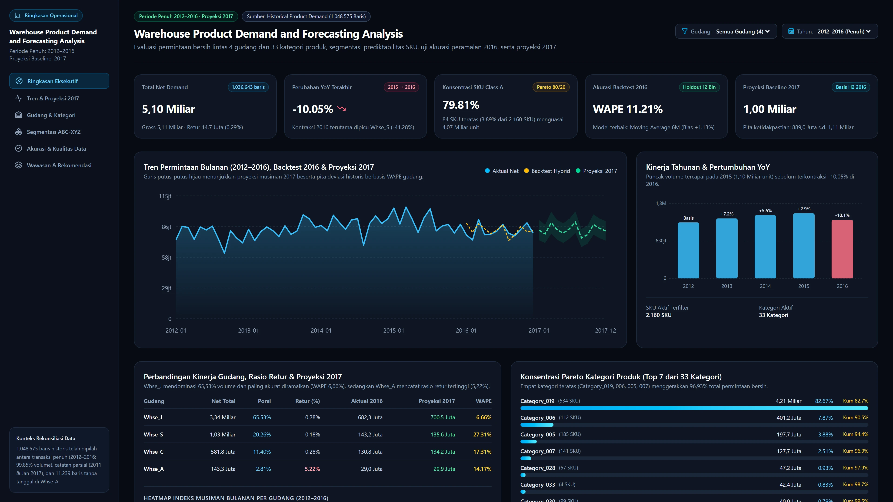
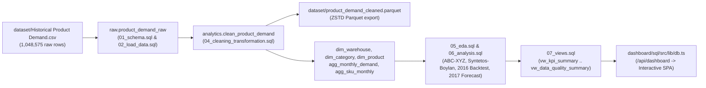
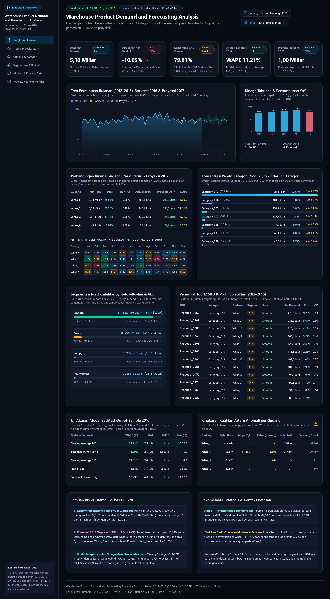

# Warehouse Product Demand and Forecasting Analysis




## Project Overview

This repository presents an end-to-end, SQL-driven warehouse product demand and forecasting analysis across 2,160 SKUs, 33 product categories, and four distribution warehouses (`Whse_J`, `Whse_S`, `Whse_C`, and `Whse_A`) spanning 2011–2017. Built on a reproducible DuckDB analytical pipeline (`script/01_schema.sql` through `script/07_views.sql`) orchestrated by Python (`script/run_sql_pipeline.py`), the project reconciles 1,048,575 raw order demand records into clean gross, return/adjustment, and net demand metrics, segments SKU predictability via ABC-XYZ and Syntetos–Boylan classification over a full 60-month grid (`2012–2016`), benchmarks five time-series baseline forecasting models using leak-free 2016 out-of-sample backtesting, projects 2017 warehouse-level demand with WAPE uncertainty bands, and delivers an interactive dark-mode SQL dashboard alongside a 15-slide executive presentation.

## Business Understanding

Multi-warehouse inventory planning requires distinguishing stable, high-volume core products from erratic or intermittent long-tail SKUs while protecting forecasting models from structural demand shifts and upstream logging anomalies. Across the historical dataset (`5.10B` net demand units), planning teams face severe Pareto concentration, a sharp 2016 contraction (`-10.05%` YoY), and concentrated return and missing-date anomalies that can distort replenishment targets if unaddressed.

- **Business Problem 1 — Extreme SKU & Category Concentration:** Without Pareto visibility, analytical and inventory control capacity risks being spread thinly across thousands of low-volume SKUs while a small core drives the vast majority of unit throughput.
- **Business Problem 2 — 2016 Structural Volume Shift:** Network demand decelerated from `+7.17%` (2013) to `+2.93%` (2015) before contracting `-10.05%` in 2016, causing static prior-year forecasts (`Seasonal Naive t-12`) to systematically over-forecast.
- **Business Problem 3 — Operational Data Quality Risks:** Missing `Date` stamps (`11,239` rows exclusively in `Whse_A`) and parenthesized negative adjustments (`10,469` rows totaling `-20.74M` units) require explicit separation of Gross Demand, Return Units, and Net Demand.
- **Project Objectives:**
  - Reconcile historical Gross, Return, and Net Demand at network, warehouse, category, and SKU levels across the complete 60-month evaluation window (`2012–2016`).
  - Classify SKU concentration and demand predictability using ABC-XYZ segmentation and the Syntetos–Boylan framework (`Smooth`, `Erratic`, `Intermittent`, `Lumpy`).
  - Benchmark five monthly forecasting baselines on a leak-free 2016 holdout (`48` warehouse-month observations) and generate a 2017 baseline projection with WAPE uncertainty bands.
- **Key Analytical Questions:**
  - How do annual growth and monthly seasonality behave across `2012–2016`, and which warehouses drove the 2016 contraction?
  - How sharply is demand concentrated across the 33 categories and 2,160 SKUs, and which segment is most suitable for automated forecasting?
  - Which baseline time-series model minimizes WAPE, MAE, RMSE, and Bias in 2016 backtesting, and what is the defensible 2017 baseline?

## Dataset & Data Sources

The primary source is a single historical order-demand CSV (`dataset/Historical Product Demand.csv`, ~48.88 MB) containing `1,048,575` records—matching the exact 1,048,576-row Excel worksheet boundary minus header—which is ingested untouched into `raw.product_demand_raw` and transformed into cleaned Parquet, monthly aggregates, SKU profiles, and a DuckDB analytical warehouse.

| Dataset | Source | Period | Rows | Columns | Format |
|---|---|---|---|---|---|
| `Historical Product Demand.csv` | Raw transactional warehouse demand export | 2011-01-08 to 2017-01-09 (+ missing dates) | 1,048,575 | 5 | CSV |
| `product_demand_cleaned.parquet` | `analytics.clean_product_demand` export | 2011-01-08 to 2017-01-09 (+ missing dates) | 1,048,575 | 17 | Parquet (ZSTD) |
| `product_demand_monthly_transformed.csv` | `analytics.agg_monthly_demand` export | 2012-01 to 2016-12 (60 full months) | 4,994 | 14 | CSV |
| `product_demand_sku_profile.csv` | `analytics.agg_sku_forecast_profile` export | 2012-01 to 2016-12 (60-month grid) | 2,160 | 13 | CSV |
| `demand_analytics.duckdb` | Consolidated raw, clean, dimensional & forecast tables | 2011–2017 (2017 forecast horizon) | Multi-table | Multi-schema | DuckDB |

## Tech Stack

| Category | Technology | Purpose |
|---|---|---|
| Analytical SQL Engine | DuckDB (`PostgreSQL`-compatible SQL) | Primary in-process SQL engine executing schema DDL, cleaning, segmentation, backtesting, and analytical views |
| Pipeline Orchestration | Python (`duckdb`, `pandas`) | Executes sequential SQL scripts, exports cleaned Parquet/CSV derivatives, runs assertions, and outputs JSON summary |
| Storage & Interchange | CSV, Apache Parquet (ZSTD), JSON | Raw source preservation, compressed cleaned dataset storage, transformed exports, and verified metric snapshots |
| Interactive Dashboard | Next.js, TypeScript, Tailwind CSS, `@duckdb/node-api` | Dark-mode single-page web application querying DuckDB views dynamically via server-side parameterized SQL |
| Visual Exports & QA | Playwright Chromium, WebP | High-resolution `full-page`, `16:9`, and `16:10` dashboard captures and visual layout verification |
| Executive Presentation | Canva | 15-slide executive analytical deck exported to both `.pptx` and `.pdf` deliverables |

## Analytical Workflow

All ten standard Data Analytics workflow stages were executed sequentially and documented inside `reports/`.

| No. | Workflow | Status | Documentation |
|---:|---|---|---|
| 1 | Business Understanding | Mandatory · Completed | [01. Business Understanding.md](reports/01.%20Business%20Understanding.md) |
| 2 | Data Understanding & Inspection | Mandatory · Completed | [02. Data Understanding.md](reports/02.%20Data%20Understanding.md) |
| 3 | Data Profiling & Quality Assessment | Mandatory · Completed | [03. Data Profiling%20%26%20Quality%20Assessment.md](reports/03.%20Data%20Profiling%20%26%20Quality%20Assessment.md) |
| 4 | Data Cleaning | Conditional · Completed | [04. Data Cleaning.md](reports/04.%20Data%20Cleaning.md) |
| 5 | Data Transformation & Preparation | Conditional · Completed | [05. Data Transformation.md](reports/05.%20Data%20Transformation.md) |
| 6 | Exploratory Data Analysis (EDA) | Mandatory · Completed | [06. Exploratory Data Analysis.md](reports/06.%20Exploratory%20Data%20Analysis.md) |
| 7 | Statistical Analysis | Conditional · Completed | [07. Data Analysis.md](reports/07.%20Data%20Analysis.md) |
| 8 | Data Visualization | Mandatory · Completed | [08. Data Visualization.md](reports/08.%20Data%20Visualization.md) |
| 9 | Insight Generation & Interpretation | Mandatory · Completed | [09. Business Insights%20%26%20Recommendations.md](reports/09.%20Business%20Insights%20%26%20Recommendations.md) |
| 10 | Reporting & Business Recommendation | Mandatory · Completed | [10. Data Analysis Presentation.md](reports/10.%20Data%20Analysis%20Presentation.md) |

## Data Cleaning

Data cleaning is implemented non-destructively in `script/04_cleaning_transformation.sql`, reading from `raw.product_demand_raw` (`VARCHAR` staging) and writing to `analytics.clean_product_demand` while preserving all `1,048,575` rows with explicit audit flags rather than performing destructive deletions or artificial date imputation.

| Rule ID | Condition Detected | Cleaning Action Applied | Affected Rows |
|---|---|---|---:|
| `R-01` | `TRIM(order_demand_raw)` matches `^\(\d+\)$` | Flag `is_parenthesized_demand = TRUE`; parse signed `-N` into `order_demand_net`, `0` into `order_demand_gross`, `ABS(N)` into `order_demand_abs` | 10,469 |
| `R-02` | `TRIM(order_demand_raw)` matches `^\d+$` | Trim trailing whitespace (`1,038,106` total integer rows) and cast to `BIGINT` | 1,038,106 |
| `R-03` | `order_date_raw IS NULL` | Flag `is_missing_date = TRUE` (`100%` in `Whse_A`); retain in warehouse totals, exclude from monthly time series | 11,239 |
| `R-04` | `order_demand_net = 0` | Flag `is_zero_demand = TRUE` (primarily `Whse_A` with `24,636` rows and `Whse_J` with `3,836` rows) | 28,681 |
| `R-05` | `ROW_NUMBER() OVER (5 columns) > 1` | Flag `is_exact_duplicate_record = TRUE` because `Order_ID` is absent; keep intact for sensitivity checks | 122,423 |

1. **Zero Parsing Failures:** All `1,048,575` demand strings and `1,037,336` non-null `YYYY/M/D` dates parsed cleanly with `0` unparseable records.
2. **No Outlier Trimming:** Bulk industrial orders up to `4,000,000` units per line (`> P99 = 75,000`) represent valid wholesale demand and are retained to preserve true warehouse capacity requirements.
3. **100% Arithmetic Reconciliation:** Automated assertions verify `raw_rows == clean_rows == 1,048,575` and `Gross (5,124,597,821) - Returns (20,735,500) = Net (5,103,862,321)`.

## Data Transformation & Preparation

Transformation scripts (`script/04_cleaning_transformation.sql` and `script/06_analysis.sql`) isolate the complete 60-month evaluation window (`2012–2016`, covering `1,036,643` rows and `99.85%` of total Net Demand) from partial boundary periods (`2011`: `640` rows; `Jan 2017`: `53` rows) and construct dimensional and aggregated tables on a complete `2,160 SKU × 60 months = 129,600` SKU-month grid.

| Analytical Table | Grain / Granularity | Rows | Scope Filter |
|---|---|---:|---|
| `analytics.dim_warehouse` | 1 row per `warehouse` | 4 | Full dataset (`1,048,575` rows) |
| `analytics.dim_category` | 1 row per `product_category` | 33 | Full dataset (`1,048,575` rows) |
| `analytics.dim_product` | 1 row per `product_code` | 2,160 | Full dataset + `2012–2016` sub-metrics |
| `analytics.agg_monthly_demand` | `order_ym × warehouse × product_category` | 4,994 | `2012-01` to `2016-12` (`NOT is_missing_date`) |
| `analytics.agg_sku_monthly` | `product_code × order_ym` | Active SKU-months | `2012-01` to `2016-12` (`NOT is_missing_date`) |
| `analytics.agg_sku_forecast_profile` | 1 row per `product_code` (60-month zero-padded grid) | 2,160 | `2012-01` to `2016-12` |

1. **Hierarchy Verification:** Confirmed a strict `N:1` mapping from `Product_Code` to `Product_Category` (`0` multi-category SKUs) while identifying an `M:N` relationship across warehouses (`1,670` single-warehouse SKUs; `28` SKUs active in all 4 warehouses).
2. **Calendar & Return Features:** Engineered `order_year`, `order_month`, `order_quarter`, `order_ym`, `day_of_week` (`ISODOW`), and `return_rate_pct` alongside `primary_warehouse` via window ranking.
3. **Zero-Padded Demand Grid:** Cross-joined all `2,160` SKUs with all `60` months so inactive months count as `0` when computing `cv_60m` and Average Inter-demand Interval (`adi`), preventing artificial smoothing of intermittent SKUs.

## Statistical Analysis

Quantitative modeling in `script/06_analysis.sql` pairs SKU-level **ABC-XYZ** and **Syntetos–Boylan** predictability segmentation (`ADI < 1.32`, `CV² < 0.49`) with a leak-free 2016 out-of-sample holdout backtest (`48` warehouse-month points trained strictly on `2012–2015` seasonal indices) across five forecasting baselines: `Naive (t-1)`, `Seasonal Naive (t-12)`, `Moving Average 3M`, `Moving Average 6M`, and `Seasonal-MA6 Hybrid`.

| Forecast Model (2016 Backtest) | Total Actual 2016 | Total Forecast 2016 | WAPE (%) | MAE (Units/Mo) | RMSE (Units/Mo) | Bias (%) |
|---|---:|---:|---:|---:|---:|---:|
| **Moving Average 6M** | 985,368,129 | 996,465,554 | **11.21%** | **2,301,615** | 3,317,016 | +1.13% |
| **Seasonal-MA6 Hybrid** | 985,368,129 | 997,122,585 | 11.29% | 2,318,233 | 3,307,789 | +1.19% |
| **Moving Average 3M** | 985,368,129 | 988,699,873 | 11.51% | 2,362,142 | **3,276,264** | **+0.34%** |
| **Naive (`t-1`)** | 985,368,129 | 993,529,946 | 15.88% | 3,258,997 | 4,260,535 | +0.83% |
| **Seasonal Naive (`t-12`)** | 985,368,129 | 1,095,444,965 | 19.29% | 3,959,733 | 6,026,552 | +11.17% |

```sql
-- Leak-free Seasonal-MA6 Hybrid backtest & 2016 benchmark evaluation (script/06_analysis.sql)
SELECT
    model_name,
    COUNT(*) AS eval_points,
    SUM(actual_demand) AS total_actual_2016,
    SUM(forecast_val) AS total_forecast_2016,
    ROUND(100.0 * SUM(ABS(actual_demand - forecast_val)) / NULLIF(SUM(ABS(actual_demand)), 0), 2) AS wape_pct,
    ROUND(AVG(ABS(actual_demand - forecast_val)), 0) AS mae,
    ROUND(SQRT(AVG(POWER(actual_demand - forecast_val, 2))), 0) AS rmse,
    ROUND(100.0 * SUM(forecast_val - actual_demand) / NULLIF(SUM(actual_demand), 0), 2) AS bias_pct
FROM unpivoted
GROUP BY model_name
ORDER BY wape_pct ASC;
```

## Data Dictionary

| Variable / Field | Source / Table | Type | Description |
|---|---|---|---|
| `Product_Code` | Raw & `dim_product` | `VARCHAR` | Unique SKU identifier (`2,160` distinct SKUs, e.g., `Product_1359`) |
| `Warehouse` | Raw & `dim_warehouse` | `VARCHAR` | Distribution warehouse code (`Whse_J`, `Whse_S`, `Whse_C`, `Whse_A`) |
| `Product_Category` | Raw & `dim_category` | `VARCHAR` | Product category identifier (`33` distinct categories, e.g., `Category_019`) |
| `order_date` | `clean_product_demand` | `DATE` | Parsed transaction date (`NULL` for `11,239` `Whse_A` records) |
| `order_demand_gross` | `clean_product_demand` | `BIGINT` | Non-negative ordered unit quantity (`GREATEST(order_demand_net, 0)`) |
| `order_demand_net` | `clean_product_demand` | `BIGINT` | Signed net demand units (`-N` for parenthesized returns, `N` for orders) |
| `abc_class` | `agg_sku_forecast_profile` | `VARCHAR` | Pareto cumulative volume class: `A` (`<=80%`), `B` (`80–95%`), `C` (`>95%`) |
| `xyz_class` | `agg_sku_forecast_profile` | `VARCHAR` | 60-month demand volatility class: `X` (`CV <= 0.50`), `Y` (`0.50–1.00`), `Z` (`>1.00`) |
| `adi` / `cv_squared` | `agg_sku_forecast_profile` | `DOUBLE` | Syntetos–Boylan Average Inter-demand Interval (`60 / positive_months`) and active-month squared CV |
| `demand_pattern` | `agg_sku_forecast_profile` | `VARCHAR` | Demand predictability regime (`Smooth`, `Erratic`, `Intermittent`, `Lumpy`) |
| `seasonal_index` | `forecast_projection_2017` | `DOUBLE` | Ratio of historical warehouse-month average demand to overall warehouse monthly average |

## SQL Queries

The analytical layer is structured as seven modular SQL scripts (`01_schema.sql` through `07_views.sql`). Below is the core Syntetos–Boylan and ABC-XYZ segmentation query from `script/06_analysis.sql` executed over the 60-month zero-padded SKU grid.

```sql
SELECT
    product_code,
    product_category,
    total_net_demand,
    ROUND(100.0 * cum_demand / NULLIF(grand_positive_sku_demand, 0), 4) AS cum_demand_pct,
    CASE
        WHEN 100.0 * cum_demand / NULLIF(grand_positive_sku_demand, 0) <= 80.0 THEN 'A'
        WHEN 100.0 * cum_demand / NULLIF(grand_positive_sku_demand, 0) <= 95.0 THEN 'B'
        ELSE 'C'
    END AS abc_class,
    ROUND(cv_60m, 4) AS cv_60m,
    ROUND(adi, 4) AS adi,
    ROUND(cv_squared, 4) AS cv_squared,
    CASE
        WHEN adi < 1.32 AND cv_squared < 0.49 THEN 'Smooth'
        WHEN adi < 1.32 AND cv_squared >= 0.49 THEN 'Erratic'
        WHEN adi >= 1.32 AND cv_squared < 0.49 THEN 'Intermittent'
        ELSE 'Lumpy'
    END AS demand_pattern
FROM ranked;
```

## Data Pipeline & ETL

The pipeline extracts raw CSV records into an immutable staging table, enforces schema validation and quality flagging, builds star-schema dimensions and time-series aggregates, evaluates forecasts, and exposes standardized views consumed by the dashboard API.



## Dashboard

The interactive analytics dashboard provides supply chain planners and warehouse operations leaders with real-time visibility into net demand trends, warehouse return disparities, Pareto SKU predictability, 2016 backtest accuracy, and 2017 baseline projections. Built as a single-page dark-mode application backed directly by parameterized DuckDB SQL queries (`dashboard/sql/`), it connects analytical modeling directly to operational filtering.



The full-page layout places global warehouse and year slicers alongside five executive KPI summary cards at the top, followed sequentially by the 2012–2017 monthly demand and uncertainty-band trajectory, annual YoY bar comparison, warehouse performance table paired with a 4×12 seasonality heatmap, Top-7 category Pareto breakdown, Syntetos–Boylan predictability cards, Top-12 SKU leaderboard, 2016 model benchmark table, warehouse data-quality audit, and evidence-based strategic action cards.

**Key Performance Indicators (KPIs):**
- **Total Net Demand**: `5.10B` units across 2012–2016 (`5.11B` gross minus `14.73M` returns, `0.29%` return rate; `5.104B` overall including boundary rows).
- **Latest YoY Change**: `-10.05%` network contraction from 2015 (`1.095B`) to 2016 (`985.37M`), driven predominantly by `Whse_S` (`-41.28%`).
- **Class A SKU Concentration**: `79.81%` of 2012–2016 net demand generated by just `84` Class A SKUs (`3.89%` of `2,160` SKUs).
- **2016 Backtest Accuracy**: Best WAPE of `11.21%` (`Moving Average 6M`, `+1.13%` bias) and `11.29%` (`Seasonal-MA6 Hybrid`, `+1.19%` bias) across 48 warehouse-month test points.
- **2017 Baseline Projection**: `1.00B` units (`1,000,086,480` total) with a warehouse WAPE-calibrated uncertainty band of `888.95M` to `1.11B` units.

**Interactive Features & Slicers:**
- **Warehouse Selector (`Gudang`)**: Filters KPIs, monthly trend/forecast series, annual growth, category Pareto, ABC-XYZ breakdown, and top-SKU tables across `ALL`, `Whse_J`, `Whse_S`, `Whse_C`, and `Whse_A`.
- **Year Selector (`Tahun`)**: Slices historical performance across `2012–2016 (Full)` or individual fiscal years (`2012` through `2016`).
- **Sidebar Section Navigation**: Smooth anchor navigation across Executive Summary, Trend & 2017 Forecast, Warehouses & Categories, ABC-XYZ Segmentation, Accuracy & Data Quality, and Insights & Recommendations.

**Deliverable & Access Links:**
- **Dashboard Source Application**: [dashboard/sql](dashboard/sql) (`src/app/api/dashboard/route.ts`, `src/lib/db.ts`, `src/components/DashboardClient.tsx`)
- **Full-Page Dashboard Export**: [dashboard_full-page.png](dashboard/exports/dashboard_full-page.png)

## Data Visualizations

Key findings, analytical methodology, model backtest comparisons, and strategic roadmaps are structured across 15 presentation slides (`Slide 01` through `Slide 15`) designed in dark mode to complement the interactive SQL dashboard:

### Slide 01 — Cover Slide & Project Identity


The opening cover slide establishes the project title, *Warehouse Product Demand and Forecasting Analysis*, authored by Yohanes Dimas Pratama in 2026. Its minimalist dark-mode layout frames the analytical scope around multi-warehouse demand reconciliation and time-series forecasting.

### Slide 02 — Executive Summary & Core KPI Highlights


The executive summary highlights four headline metrics: `5.10B` cumulative 2012–2016 net demand, `84` Class A SKUs controlling `79.81%` of total volume, a `-10.05%` contraction in 2016 triggered primarily by `Whse_S` (`-41.28%`), and a `1.00B` unit 2017 baseline projection (`889M–1.11B` band). It also underscores the core modeling takeaway that 6-month adaptive baselines (`MA-6` at `11.21%` WAPE and `Seasonal-MA6 Hybrid` at `11.29%`) decisively outperform `Seasonal Naive` (`19.29%`).

### Slide 03 — Business Context & Problem Statement


This slide frames the operational footprint across `2,160` SKUs, `33` categories, and `4` distribution warehouses (`Whse_J`, `Whse_S`, `Whse_C`, `Whse_A`). Three foundational planning challenges are isolated: extreme SKU and category concentration, an abrupt 2016 demand level shift, and concentrated missing-date and return anomalies in `Whse_A`.

### Slide 04 — Business Objectives & Analytical Questions


Four structured pillars translate operational pain points into testable analytical objectives: reconciling Gross, Return, and Net Demand; mapping dominant, stable, and intermittent SKUs; benchmarking models without data leakage; and establishing a defensible 2017 baseline. Each objective links directly to quantitative SQL deliverables and error metrics.

### Slide 05 — Dataset Overview & Evaluation Scope


The dataset timeline contrasts the full `1,048,575` raw records (`2011–2017`) against the complete 60-month analytical window (`2012–2016`), which captures `1,036,643` rows and `99.85%` of total net demand. It also flags the partial boundary records (`640` rows in `2011` and `53` rows in `Jan 2017`) and highlights that `1,048,575` rows equals the exact spreadsheet export limit, signaling potential truncation risk in upstream data extraction.

### Slide 06 — Data Quality Audit & Preparation Reconciliation


Four audit cards quantify the dataset's structural anomalies: `11,239` missing-date rows (`100%` in `Whse_A`, carrying `70.7%` of `Whse_A` return volume), `10,469` parenthesized negative entries (`-20.74M` return units), `28,681` zero-demand rows, and `122,423` repeated 5-column records flagged because `Order_ID` is absent. A bottom reconciliation flow confirms 100% unit conservation (`5.12B` Gross minus `20.74M` Returns equals `5.10B` Net).

### Slide 07 — Analytical Methodology & Leak-Free Pipeline


The methodology flow illustrates the five-stage analytical pipeline from raw-vs-clean separation through the full `2,160 SKU × 60-month` zero-padded grid, ABC-XYZ and Syntetos–Boylan segmentation (`ADI = 1.32`, `CV² = 0.49`), 2016 out-of-sample backtesting trained strictly on `2012–2015`, and 2017 projection generation. Model selection is governed consistently by WAPE, MAE, RMSE, and Bias without data leakage.

### Slide 08 — Overall Warehouse Performance & Return Rates


This slide summarizes 2012–2016 full-period totals (`5.11B` Gross, `14.73M` Returns at `0.29%`, `5.10B` Net) alongside a horizontal warehouse share distribution led by `Whse_J` (`65.53%`), `Whse_S` (`20.26%`), `Whse_C` (`11.40%`), and `Whse_A` (`2.81%`). A dedicated callout spotlights `Whse_A`, where despite contributing under `3%` of volume, the overall return rate spikes to `5.22%`, signaling data and process quality gaps.

### Slide 09 — Category Concentration & SKU Predictability


A Pareto bar chart reveals that `Category_019` alone accounts for `82.67%` of net demand and the Top 4 categories generate `96.93%` of total throughput. Adjacent KPI cards demonstrate that `639` `Smooth` SKUs (`29.58%` of SKUs) drive `89.60%` of volume—anchored by `57` `A-X Smooth` SKUs (`63.41%` volume, average `CV = 0.30`) and led by `Product_1359` (`470.6M` units)—making automated forecasting highly effective on the core portfolio.

### Slide 10 — Annual Growth Trajectory, Whse_S Shift & Seasonality


The annual growth line chart traces steady deceleration from `+7.17%` (2013) to `+5.46%` (2014) and `+2.93%` (2015) before dropping sharply to `-10.05%` in 2016. Warehouse callouts show that `Whse_S` fell `-41.28%` YoY (with order lines down `67%` and returns up `6.1x`) while `Whse_C` grew `+4.55%`, and seasonal indices confirm recurring network peaks in March (`1.09`) and July (`1.08`) versus an August trough (`0.91`).

### Slide 11 — 2016 Backtest Benchmark & 2017 Baseline Projection


Benchmark bars confirm that 6-month adaptive models (`MA-6` at `11.21%` WAPE, `+1.13%` bias; `Seasonal-MA6 Hybrid` at `11.29%` WAPE, `+1.19%` bias) cut forecast error by roughly 8 percentage points compared to `Seasonal Naive` (`19.29%` WAPE). Warehouse diagnostics contrast `Whse_J`'s high predictability (`6.66%` Hybrid WAPE) with `Whse_S` (`27.31%` Hybrid vs `70.31%` Seasonal Naive), framing the `1.00B` unit 2017 projection (`889M–1.11B` uncertainty band).

### Slide 12 — Business Insights & Decision Boundaries


Three insight cards synthesize the operational implications: prioritize forecast automation on the `639` `Smooth` and `84` Class A SKUs covering dominant volume; adopt a 6-month adaptive baseline window to limit overstock risk during structural demand shifts; and maintain strict decision boundaries recognizing that correlation does not establish causality until `Whse_S` changes are validated commercially.

### Slide 13 — Prioritized Recommendations & Action Plan


The action roadmap organizes five initiatives into P1 (`0–60` days) and P2 (`60–90` days) execution tiers. Immediate P1 actions migrate `Smooth` SKUs to `Seasonal-MA6 Hybrid / MA-6`, enforce mandatory date validation on `Whse_A` returns, and audit `Whse_S` accounts, while P2 initiatives apply quantile safety stock to `1,414` `Erratic`/`Lumpy` SKUs and remove spreadsheet row limits from ETL extraction.

### Slide 14 — Conclusion & Next Analytical Steps


This closing summary highlights the ~8 percentage-point WAPE improvement achieved by replacing static annual baselines with an adaptive, auditable SQL forecasting workflow. Three next-step priorities extend the framework toward financial optimization: integrating unit price and margin data, incorporating inventory holding costs, and automating monthly KPI tracking.

### Slide 15 — Appendix & Supporting Methodological Notes


The appendix consolidates standard definitions across KPI calculations (`Gross`, `Return`, `Net`, `WAPE`), segmentation thresholds (`ABC`, `XYZ`, `ADI`/`CV²`, `Smooth`), and analytical limitations (`5` models evaluated on 2016, top SKU `Product_1359`, absence of `Order_ID` for exact deduplication, and non-causal scope). This reference ensures consistent interpretation among technical and executive stakeholders.

## Key Findings & Insights

The analysis reveals a highly skewed, predictable core surrounded by localized operational shifts and data-logging anomalies:

- **Extreme Pareto Concentration:** `84` Class A SKUs (`3.89%` of `2,160` SKUs) drive `79.81%` of 2012–2016 net demand, and `Category_019` alone contributes `82.67%` (`4.21B` units; Top 4 categories = `96.93%`).
- **Predictable Core Portfolio:** `639` `Smooth` SKUs (`29.58%` of SKUs) generate `89.60%` of total demand, led by `57` `A-X Smooth` SKUs (`63.41%` volume, mean `CV = 0.30`), whereas `1,414` `Erratic`/`Lumpy` SKUs (`65.46%` of SKUs) represent just `9.93%` of volume.
- **Localized 2016 Structural Contraction:** Network net demand dropped `-10.05%` in 2016 primarily due to `Whse_S` (`-41.28%` YoY, order lines `-67.0%`, returns up `6.1x`), while `Whse_C` expanded every year (`+4.55%` in 2016; `+38.3%` since 2012) and `Whse_J` remained resilient (`-2.16%`).
- **Adaptive 6-Month Models Outperform Static Seasonality:** On 2016 holdout backtesting, `Moving Average 6M` (`11.21%` WAPE) and `Seasonal-MA6 Hybrid` (`11.29%` WAPE) cut error by ~8 percentage points versus `Seasonal Naive` (`19.29%` WAPE, `+11.17%` bias).
- **Whse_A Data Quality & Return Anomaly:** All `11,239` missing-date rows reside in `Whse_A` and contain `70.7%` of `Whse_A`'s total return units (`5.57M` of `7.88M`), resulting in an elevated `5.22%` return rate compared to `0.18%–0.28%` at the other warehouses.

| Finding | Evidence / Metric | Interpretation |
|---|---|---|
| Core Volume Predictability | `639` `Smooth` SKUs = `89.60%` volume; `57` `A-X Smooth` = `63.41%` | Nearly 90% of unit throughput is suited for automated statistical time-series forecasting |
| Long-Tail Volatility | `1,414` `Erratic`/`Lumpy` SKUs (`65.46%` SKUs) = `9.93%` volume | Point forecasts add noise on long-tail SKUs; quantile safety stock / Min-Max policies fit better |
| Warehouse Divergence (`2016`) | `Whse_S` `-41.28%` YoY vs `Whse_C` `+4.55%` & `Whse_J` `-2.16%` | The 2016 network contraction is concentrated in `Whse_S`, not a uniform network downturn |
| Backtest Bias Reduction | `MA-6` `11.21%` WAPE (`+1.13%` bias) vs `Seasonal Naive` `19.29%` (`+11.17%`) | Adaptive 6-month baselines prevent severe over-forecasting during demand level shifts |
| Upstream Logging Risk | `11,239` null dates in `Whse_A`; `1,048,575` exact CSV rows | Mandatory date validation and direct DB extraction are required to prevent truncation and blind spots |

## Reporting & Business Recommendations

Replacing static annual baselines with segmented, adaptive 6-month forecasting alongside targeted warehouse data governance provides immediate accuracy gains without adding modeling complexity across low-volume long-tail SKUs. Note that unit prices, holding costs, and `Order_ID` keys are absent from the source dataset, so ABC tiers reflect unit volume rather than financial margin and causal drivers of the `Whse_S` contraction require commercial validation.

1. **Deploy Segmented Forecasting by Syntetos–Boylan & ABC-XYZ Class (Priority: High, 0–30 Days):** Automate monthly replenishment baselines using `Seasonal-MA6 Hybrid` or `Moving Average 6M` for the `639` `Smooth` SKUs (`89.60%` volume) with weekly planner reviews focused on the `84` Class A SKUs (`target: network WAPE < 11%, Whse_J WAPE < 7%, Bias within ±3%`).
2. **Replace Annual `t-12` Naïve Rules with Adaptive 6-Month Windows & Level-Shift Triggers (Priority: High, 0–30 Days):** Retire `Seasonal Naive` forecasting rules that introduced `+11.17%` over-forecast bias during 2016 (`70.31%` WAPE at `Whse_S`) in favor of rolling 6-month deseasonalized levels.
3. **Enforce Mandatory Date Validation & Return Audits at `Whse_A` and `Whse_S` (Priority: High, 0–60 Days):** Require valid transaction dates on all `Whse_A` return and adjustment postings (`target: 0% missing-date rows`) and conduct commercial/account reviews at `Whse_S` to diagnose the `-67%` order-line drop and `6.1x` return surge.
4. **Shift `1,414` `Erratic`/`Lumpy` SKUs to Quantile Safety Stock Policies (Priority: Medium, 60–90 Days):** Manage low-volume, high-variance Class B/C SKUs (`9.93%` volume) via Min-Max / empirical quantile buffers rather than point-forecast optimization.
5. **Eliminate Spreadsheet-Limited Source Extraction (Priority: Medium, 60–90 Days):** Migrate upstream order-demand extracts to direct database/ETL pipelines so records are never truncated at the `1,048,575`-row spreadsheet ceiling.

## Analysis Presentation

The executive presentation synthesizes the business problem, data reconciliation audit, ABC-XYZ and Syntetos–Boylan segmentation, 2016 backtesting benchmark, 2017 projections, and prioritized action plan into a 15-slide dark-mode deck designed in Canva and exported in both editable and distribution-ready formats.

- **Key Presentation Highlights:** Executive KPI scorecard (`5.10B` net demand, `79.81%` Class A share, `-10.05%` 2016 contraction, `1.00B` 2017 projection), warehouse comparison, Pareto and predictability breakdowns, backtest WAPE comparisons, and a 0–90 day P1/P2 implementation roadmap.
- **PowerPoint Presentation (`.pptx`)**: [Warehouse Product Demand and Forecasting Analysis.pptx](presentation/Warehouse%20Product%20Demand%20and%20Forecasting%20Analysis.pptx)
- **PDF Presentation (`.pdf`)**: [Warehouse Product Demand and Forecasting Analysis.pdf](presentation/Warehouse%20Product%20Demand%20and%20Forecasting%20Analysis.pdf)

## Reproducibility & Execution

Both the DuckDB SQL analytical pipeline and the interactive Next.js SQL dashboard can be reproduced locally from the repository root.

1. **Clone the repository and navigate into the project directory:**
   ```bash
   git clone https://github.com/weztcy/Warehouse-Product-Demand-and-Forecasting-Analysis.git
   cd "Warehouse Product Demand and Forecasting Analysis"
   ```
2. **Create a Python virtual environment and install pipeline dependencies:**
   ```bash
   python -m venv .venv
   # Windows PowerShell:
   .venv\Scripts\Activate.ps1
   # macOS/Linux:
   # source .venv/bin/activate
   pip install duckdb pandas pyarrow
   ```
3. **Run the reproducible SQL pipeline (`01_schema.sql` through `07_views.sql`):**
   ```bash
   python script/run_sql_pipeline.py
   ```
   This rebuilds `dataset/demand_analytics.duckdb`, exports `dataset/product_demand_cleaned.parquet`, `dataset/product_demand_monthly_transformed.csv`, `dataset/product_demand_sku_profile.csv`, and `dataset/sql_analysis_summary.json`, and asserts 100% row and volume reconciliation.
4. **Launch the interactive dark-mode SQL dashboard locally:**
   ```bash
   cd dashboard/sql
   npm install
   npm run build
   npm run start
   ```
   Open `http://localhost:3000` in a browser to filter KPIs, time series, warehouse heatmaps, and forecasts interactively against DuckDB.

## Contributing

Contributions to enhance forecasting models, extend SQL views, or improve dashboard interactivity are welcome following a standard pull-request workflow:

1. Fork the repository.
2. Create a feature or fix branch (`git checkout -b feature/your-improvement`).
3. Make your changes to SQL scripts, pipeline code, or dashboard components.
4. Validate changes by re-running `python script/run_sql_pipeline.py` and `npm run build` inside `dashboard/sql/`.
5. Commit and push the branch to your fork.
6. Open a pull request with a clear explanation of the analytical or visual improvement.

## License

This project is licensed under the MIT License.
See the [LICENSE](LICENSE) file for details.

## Author & Contact

**Yohanes Dimas Pratama**

- GitHub: [github.com/weztcy](https://github.com/weztcy)
- Portfolio: [yohanesdimas.com](https://yohanesdimas.com)
- LinkedIn: [linkedin.com/in/yohanes-dimas](https://www.linkedin.com/in/yohanes-dimas)
